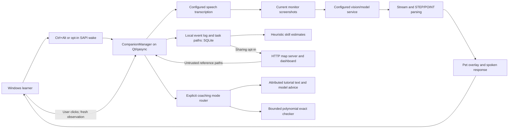
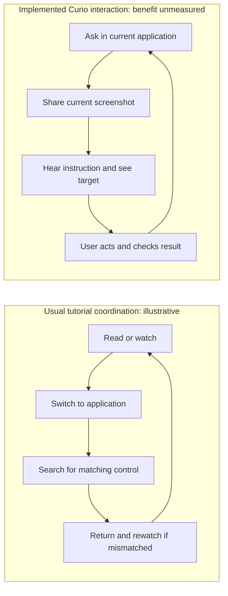

# Curio judging package

**Curio is a Windows voice companion that explains the screen and points
through unfamiliar software tasks, with recorded paths and inspectable estimates
to inform later help.**

Audience hypothesis: students and self-directed learners trying an unfamiliar
task in feature-rich Windows software. Demonstrate one prepared application and
version. This is not a validated market segment.

Baseline and fresh verification: [readiness register](../hackathon-readiness.md).
Supporting reviews: [product](../readiness/product/handoff.md),
[integrity](../readiness/integrity/handoff.md),
[impact](../readiness/impact/handoff.md), [demo](../readiness/demo/handoff.md).
Latest coordinator integration: [review and results](../readiness/integration-review.md).
The strongest technical angle is assistance context that can change on the next
encounter; live model adherence and learner benefit remain unmeasured.

## Three-minute demo

Rehearse on the actual laptop. Use a disposable worksheet and a task whose
correct result the presenter can check independently. Do not invent a successful
run. Stop a slow live request after the allocated slot and explain the failure.

| Time | Presenter says / does | Evidence boundary |
| --- | --- | --- |
| 0:00–0:20 | “When tutorial instructions don't match your screen, finding the next control can interrupt learning. We built a companion for unfamiliar software tasks.” Show the starting worksheet and goal | Problem hypothesis; no measured time savings |
| 0:20–0:45 | Hold Ctrl+Alt, ask the rehearsed question, release. Explain that current screenshots go to the configured model | Live only if actual capture/inference runs; disclose provider |
| 0:45–1:15 | Let Curio speak and point; user performs one instruction. Show a fresh-screen continuation and independently inspect the actual result | Pointer/model advice can be wrong; arbitrary clicks are not proof |
| 1:15–1:35 | Press Esc, ask another question or return to idle. Explain strict hotkey and stale-result/cancellation boundaries | Live cancellation, or clearly labeled component evidence |
| 1:35–2:00 | Show the architecture below. Highlight Qt/qasync, local speech, configured vision, real SQLite and optional shared references | Implementation depth; avoid “entirely local” |
| 2:00–2:20 | Show the later-request trace and Skills evidence. Explain reusable context, estimated help, and synthetic warning when seeded | Real persistence/request construction; scripted model behavior, not learning gains |
| 2:20–2:45 | Tell one engineering story below; identify the regression and actual latest checks in the register | Historical commits versus fresh tests are distinct |
| 2:45–3:00 | “Human benefit is our next test: correct task completion, failures and an unassisted follow-up. Today we can show the prototype and its boundaries.” | Pilot prepared, no participant results |

Prepare a genuine backup recording before judging; none was produced during this
session. Name it with capture date, checkout and environment. If no recording is
available, show architecture and actual test logs as component evidence.
The [seeded Qt exhibit](../readiness/demo/seeded-offscreen-tutor.png) is now
readable and labeled on-image. It demonstrates exact rejection/correction of
typed equations with real Qt; no live model, OCR, microphone or audio.
The native SAPI probe had eight access-denied failures, Qt exposed zero voices,
and the local model probe timed out. Use the technical fallback until actual
desktop permissions/audio/model access is rehearsed successfully.

## Visual architecture

Local speech/storage does not imply local model inference. Screenshots and
selected document text may reach the configured provider. Shared free text can
contain identifying content even when IDs/window titles are omitted. Ordinary
completion is model-inferred. Exact checking applies only to supported math.

## Before and after workflow

Illustrative workflow, not a measured comparison:

No invented click savings, durations or success percentages accompany this visual.

## Evidence legend

| Label | Meaning | What it cannot establish |
| --- | --- | --- |
| LIVE | Actual microphone/screen/provider/output run in front of judges | General reliability or human benefit |
| RECORDED | Genuine earlier run with date/commit/environment | A current live result |
| AUTOMATED / COMPONENT | Executed assertions; name real components and mocked boundaries | Live model correctness, microphone accuracy or user outcomes |
| SIMULATED / SEEDED | Generated model replies, clicks, histories or map records | Real people, adoption, knowledge or successful tasks |
| RESEARCH | Product worker's documented primary-source review, with access limits | Curio efficacy or a hands-on competitor benchmark |
| HYPOTHESIS / PLANNED | Intended benefit, pilot or feature goal | An implemented capability or measured result |

## Three traceable engineering stories

1. **Shortcut recovery after ordinary typing.** Uppercase press and lowercase
   release could leave a phantom held key and block Ctrl+Alt. Commit
   `integration snapshot` normalizes key identity using
   virtual-key codes and reconciles missed releases. See
   [hotkey source](../../curio-py/curio/hotkey.py) and
   [regressions](../../curio-py/tests/test_hotkey_stuck_keys.py).
   Strict chord handling protects intentional microphone activation but requires
   robust key bookkeeping. Physical keyboard smoke remains necessary.
2. **Unreliable model step totals.** A `1/1` STEP could terminate a multi-action
   task early. Commit `integration snapshot` treats totals as display data and continues until
   STEP tags stop, taking a fresh screenshot after clicks. See
   [manager](../../curio-py/curio/companion_manager.py) and
   [walkthrough tests](../../curio-py/tests/test_walkthrough.py).
   This improves control flow; model completion remains an unverified assertion.
3. **Sharing experience without granting it authority.** Commit `integration snapshot`
   integrates independent event, task, sync and skill components. A real loopback
   server plus separate stores checks reuse across clients while model replies
   and clicks are simulated. See
   [end-to-end tests](../../curio-py/tests/test_learning_end_to_end.py).
   Shared text enters prompts as untrusted reference data, and window titles are
   omitted. Free text is not guaranteed anonymous; actual two-laptop and firewall
   testing remains open. Readiness review further corrected “verified” wording
   and excluded inactivity from knowledge penalties.

## Judge Q&A

**What is distinctive?** The integration of a desktop companion, voice/screen
pointing, reusable walkthrough references and concept-based help. Screen-aware
guidance has prior art; first-ever/unique claims are unsupported.

**How do you know it worked?** Independently inspect the target task result.
Ordinary STEP progression records model-reported completion. The math tutor has
a separate exact checker for a deliberately bounded polynomial subset.

**Did users learn?** We have no Curio learner outcome measurements. Skill
bars are heuristic estimates. The prepared pilot includes failures and immediate
unassisted transfer; durable learning would need a stronger delayed evaluation.

**Is it private/offline?** Speech/storage can be local, but the configured model
may receive screenshots/text. Sharing is optional and free text may identify
someone. Offline exact math/component checks do not replace a vision model.

**Does hands-free act for me?** No: it starts/submits voice capture. The user
performs desktop actions. Voice interruption during playback is not included;
Ctrl+Alt interrupts.

**How reliable is it?** Cite the latest actual automated counts in the register,
including skips and lint failures. Tests with mocks do not establish real-device
accuracy, live latency, packaging or safe advice across arbitrary software.

**What is next?** A consented single-application pilot and actual laptop/projector
failure rehearsal take priority over more features.
Use the impact worker's [Calc study plan](../readiness/impact/study-plan.md),
blank-results.csv and analyze.py; earlier generic templates use a different schema.

## Network/model failure fallback

1. Name the failed stage and stop waiting at the demo time boundary. Use Esc or
   Ctrl+Alt as appropriate; do not expose configuration secrets while diagnosing.
2. Show the actual error/recovery behavior. Switch to a genuine labeled recording
   if prepared. Say “recorded run,” identify environment and continue narration.
3. Without a recording, use the architecture and fresh automated test evidence.
   Demo recovery tests use mocked HTTP, not a live outage. A typed exact-checker
   example can illustrate the offline math slice only.
4. Explain the remaining network/VPN/tunnel/model dependency and continue Q&A.
   Never present canned output, seeded counts or a replay as live inference.
